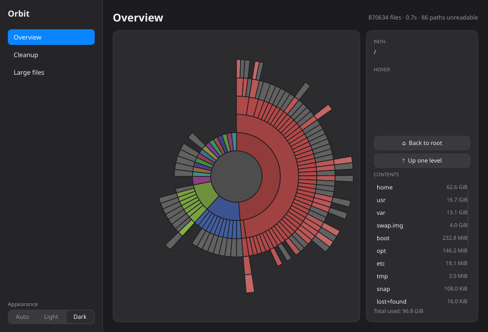

<p align="center">
  
</p>

<h1 align="center">Orbit</h1>

<p align="center">A lightweight disk usage analyzer and cleaner for Linux. CPU-only, no GPU needed.</p>

<p align="center">
  <a href="https://github.com/atasoglu/orbit/actions/workflows/ci.yml"></a>
  <a href="https://github.com/atasoglu/orbit/releases"></a>
  <a href="LICENSE"></a>
  
  
  
</p>

<p align="center">
  
</p>

## Features

- **Fast scan** of the whole disk (~1 s for 900k files), around 25 MB of memory.
- **Interactive sunburst chart**: hover for details, click to focus, double-click to zoom.
- **Cleanup suggestions** with risk levels: app and package caches, `node_modules`, Rust `target`, Python venvs, old snaps and kernels.
- **Large files** view with "Show in Files" and "Move to Trash".
- **Light / Dark / Auto** theme, rendered on the CPU (Slint software renderer).

## Install

Download the `.deb` from the [releases page](https://github.com/atasoglu/orbit/releases):

```sh
sudo apt install ./orbit_*.deb
```

Or build for your user only (needs a Rust toolchain):

```sh
./packaging/install.sh
```

**Admin scan** (reading root-only folders) is available with the `.deb` only. The user-level install never enables it, because a root helper must live in a root-owned path.
A copy in `~/.local` takes precedence over the system one.

## Safety

- Nothing is removed automatically; you pick items and confirm.
- Home-folder items go to the Trash by default (or are deleted permanently if you choose).
- System tasks (apt cache, journal, old snaps and kernels) run through `pkexec` with one password prompt. Their commands are fixed in the code.

## Development

```sh
cargo build --release --workspace
cargo test --workspace
./target/release/orbit          # GUI
./target/release/orbit-cli /    # text summary; `orbit-cli cleanup` lists candidates
./packaging/build-deb.sh        # .deb and tarball in dist/
```

Crates: `core` (scanner, cleanup rules), `chart` (CPU sunburst), `app` (Slint GUI), `helper` (read-only scan for root), `cli`.

## License

[MIT](LICENSE)
